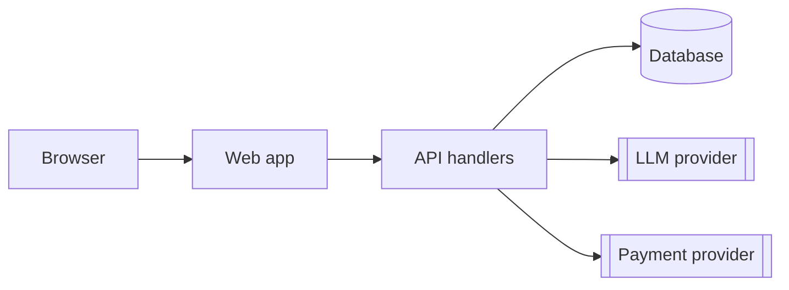

# P7 outputs - three documents

Written into `<repo>/docs/takeover/`. Each states its date, the commit it describes
(`git rev-parse --short HEAD`) and the skill version, so a reader knows what tree it is
about. Every number comes from the store, recon or a command; a value you did not measure
is written as "not measured" with the reason, never estimated. No env values, no secrets,
no personal data - an exposed secret is described by file, line and variable name.

## control-report.md

The stakeholder document: a manager reads the first screen, an engineer the rest.

```
# Control report - <app name>
<date> - commit <sha> - takeover-app <version>

## Summary
<3-5 sentences: what the app is, its overall state, the number of stop-ship problems,
and the one decision needed from the reader.>

| | count |
|---|---|
| Tier 0 - stop-ship | <n> |
| Tier 1 - before production | <n> |
| Tier 2 - soon after | <n> |
| Tier 3 - backlog | <n> |
| Imported from Azure DevOps | <n> (<m> overlap with scan findings) |

## Stack
<one line per layer: front end, back end, data, auth, hosting, CI, LLM providers -
from recon, with versions.>

## Health by lens
| Lens | Headline metric | Value | Target | Features measured | Not measured |
|---|---|---|---|---|---|
| Security depth | <field> | <n> | 0 | <n>/<m> | <why> |
| API & LLM calls | ... |
| Backend performance | ... |
| Money & privacy | ... |
| Development / Security / Design / Performance (built-in) | ... |

## Tier 0 - stop-ship
Per item: **<id> <title>** (<risk class>, <feature>) - what is wrong, the `file:line`,
the entry point that reaches it, the consequence in business terms, the proposed fix and
its size. ADO items carry their `ADO #<n>` link.

## Tier 1 - before production
The same shape, one paragraph each.

## Readiness gap
The readiness dimensions below "ready", from readiness.md, one line each with the
consequence (no error tracking -> failures in production are invisible).

## Two-week plan
| Week | Batch | Items | Gate |
|---|---|---|---|
| 1 | Tier 0: <lens> | <ids> | operator triage of pack <k> |
| 1-2 | UX: <screens> | /perfect | operator review |
| 2 | Tier 1: <lens> | <ids> | ... |
What is deliberately left for later, and why.

## What was not measured
Each lens field and dimension with no reading, and the reason (no harness, app did not
boot, no ADO access, money lens on code with no money paths). An absence here is a
known unknown, not a clean bill.
```

## architecture.md

The map a new engineer reads first. Built from the context map, recon and the code.

~~~
# Architecture - <app name>
<date> - commit <sha>

## Modules
| Module (context group) | Contexts | Entry points | Owns data | Notes |
|---|---|---|---|---|

## Data flow
<request path for the 2-3 most important flows: entry point -> handler -> service ->
store -> external call, each hop with file:line.>

## External calls
| Service | Purpose | Called from | Timeout | Retry | Credential (env NAME) |
|---|---|---|---|---|---|

## LLM touchpoints
| Call site | Provider / model | Input (does it carry PII?) | Limits (timeout, max tokens) | Traced | Key server-side only |
|---|---|---|---|---|---|

## Diagram


## Known structural problems
<cross-module coupling, duplicated logic, dead modules - each with evidence and a link
to its proposal id.>
~~~

Keep the diagram to the modules and external systems that exist; one box per context
group, one per external service, arrows only where recon found a call.

## readiness.md

The 15 readiness dimensions, scored. With `/passport-onboard` available, its assessment
fills this table; without it, score the condensed checklist below yourself.

```
# Readiness - <app name>
<date> - commit <sha> - source: passport-onboard <version> | condensed checklist

| # | Dimension | Level | Evidence | Gap -> proposal |
|---|---|---|---|---|
| 1 | Context coverage | partial | 41 contexts, 78% of src | ... |
```

Levels: `none` / `partial` / `ready` / `n/a` (with the reason). Each gap that should be
built becomes a proposal or names an existing one.

### Readiness

The condensed checklist - the canonical passport's 15 dimensions and the check behind
each, in its order (foundation, environments, quality, cost):

| # | Dimension | Ready when | Check |
|---|---|---|---|
| 1 | Context coverage | a context map covers the shipped source | P2 coverage.mjs: >=80% claimed |
| 2 | Agent instructions | `CLAUDE.md`/`AGENTS.md` carries real build, test, lint, run commands, architecture, done-criteria | read it; a stub is none |
| 3 | Documentation | a real README and a docs tree that matches the code | README length and accuracy, `docs/` census |
| 4 | Agent memory | a memory convention exists and is current | `MEMORY.md` / `.claude/memory/` |
| 5 | Reusable skills | the repo links the skills its workflow uses | `.claude/skills/`, `.ai/manifest.yaml skills:` |
| 6 | Hosting | each environment has a known deploy target and auth | recon section 6 |
| 7 | Database & migrations | versioned migrations, a per-environment database story | recon section 5 |
| 8 | Auth | the auth method is complete per environment, env names documented | recon sections 5 and 7 |
| 9 | CI | required checks block merges; environments promoted by artifact | recon section 6 (branch protection: ask) |
| 10 | Tests | the 2-3 critical paths are covered and the suite is green | test count, run it |
| 11 | Evals | each LLM call site's core behaviour has scored cases | recon section 4; `evals/` |
| 12 | Observability | errors, logs, metrics reach a monitoring service in test and prod | error-tracking SDK and its init |
| 13 | LLM tracking | model calls are traced with tokens and cost per environment | langfuse / helicone / langsmith / OTel at the call chokepoint |
| 14 | Security | dependency audit and secret scanning in CI; trust boundaries validated | CI steps, tracked `.env` files, P4 security lenses |
| 15 | App cost | a cost file lists every paid service (hosting, db, monitoring, LLM) | `app-cost.json`; never invent a price |

A dimension with no LLM calls (11, 13) is `n/a`, not `ready`.
